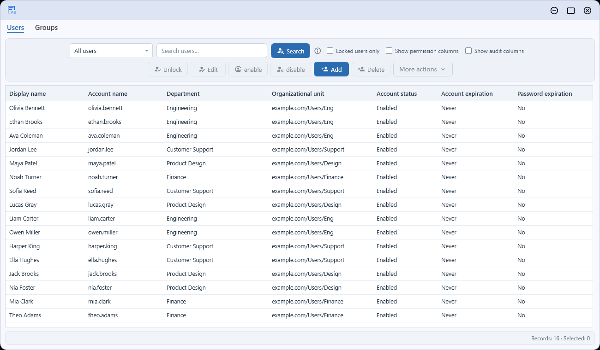
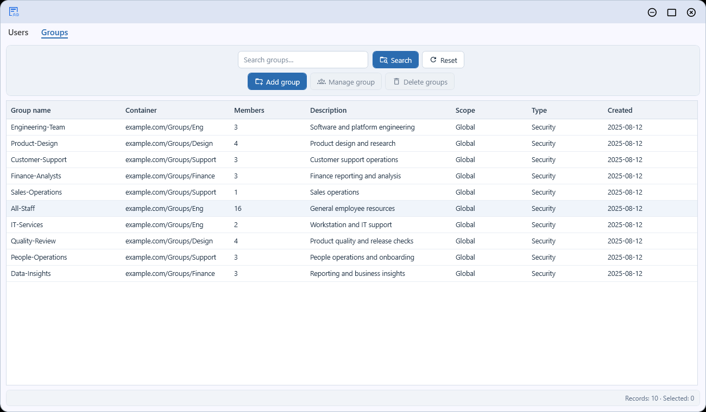
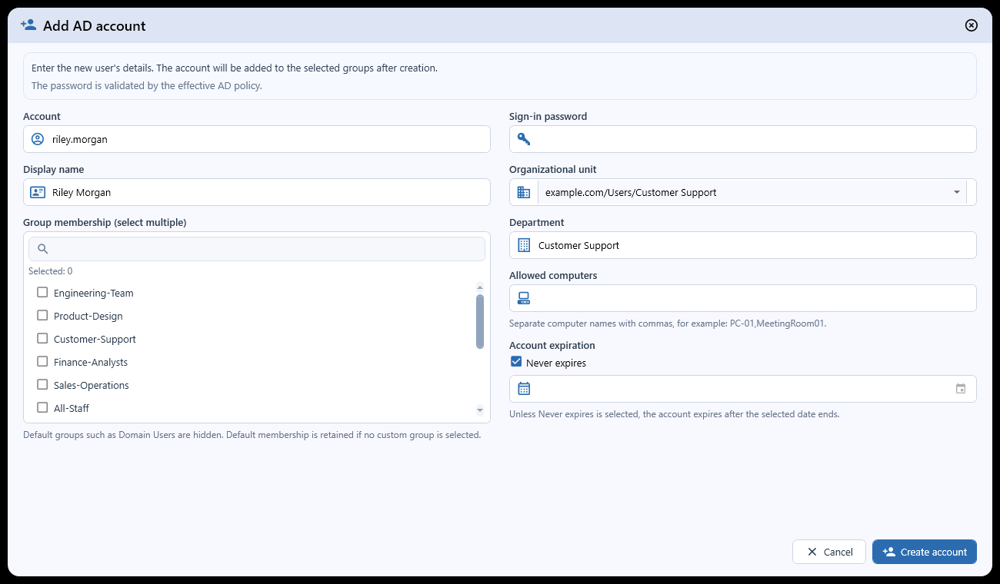
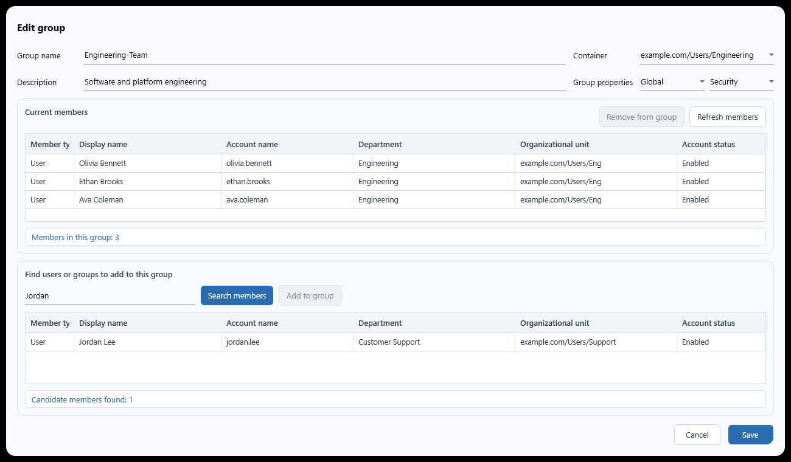

# AD Admin Desk

**Manage on-premises Active Directory users and groups on Windows.**

[English](#english) | [简体中文](#简体中文)

## English

AD Admin Desk is a Windows desktop application for IT administrators who manage users and groups in on-premises Active Directory. It uses WPF and targets .NET Framework 4.7.2. The actions available to an operator depend on delegated AD permissions.

### Features

- Search users and filter by organizational unit (OU), including descendant OUs in the connected domain, or by lock state.
- Create, edit, and delete users; enable, disable, or unlock accounts.
- Reset passwords, set account expiration, and require a password change at next sign-in.
- Search, create, edit, and delete groups; manage direct user or group membership.
- Show each batch-operation result; failed or unconfirmed writes are not retried automatically.

Group membership views list direct members and do not recursively expand nested groups. The tool manages on-premises Active Directory and does not manage Microsoft Entra ID.

### Screenshots

Captured from the running WPF application with fictional sample data.

<table>
  <tr>
    <td width="50%" valign="top">
      
      
<strong>User Management</strong> Search users and filter by OU and lock state.

    </td>
    <td width="50%" valign="top">
      
      
<strong>Group Management</strong> Browse and filter groups and organizational units.

    </td>
  </tr>
  <tr>
    <td width="50%" valign="top">
      
      
<strong>Create Account</strong> Enter account details and choose an OU and initial groups.

    </td>
    <td width="50%" valign="top">
      
      
<strong>Manage Group Membership</strong> Review direct members and add or remove membership.

    </td>
  </tr>
</table>

### Requirements and permissions

Requires a Windows desktop environment, .NET Framework 4.7.2 or a compatible later version, and access to the target domain controller. Read-only queries do not require Domain Admin membership. Create, edit, delete, password-reset, and group-membership operations require the corresponding delegated AD permissions. Running as a Windows administrator does not grant AD permissions.

Domain-joined Windows computers attempt to discover a domain controller; enter a server address manually if discovery is unavailable.

### Download and use

Current stable release: **v1.0.1** · [Download the Windows installer or portable build](https://github.com/qishouvip/ADAdminDesk-Releases/releases/latest)

Run `ADAdminDesk-win-Setup.exe` to install, or extract the complete `ADAdminDesk-win-Portable.zip` and run `ADAdminDesk.exe`. Sign in with an account that has the required AD permissions and verify the SHA-256 checksum of the download.

### Local data and updates

Remember Password is optional and off by default; saved passwords are protected with DPAPI for the current Windows user. Operation logs record the operator, target, and outcome, but not passwords. They are not tamper-proof audit records.

The application checks for updates at startup and every five minutes, with a 10-second request timeout. Automatic check failures are silent. When an update is available, it shows localized notes and opens the Release page after user confirmation. It does not automatically download, install, overwrite, or restart the application.

Software terms and third-party notices are included in the ZIP. The source repository is private: [qishouvip/ADAdminDesk](https://github.com/qishouvip/ADAdminDesk).

## 简体中文

AD Admin Desk 是一款 Windows 桌面管理工具，帮助 IT 管理员使用现有 AD 账号完成日常用户和用户组管理。软件基于 WPF 和 .NET Framework 4.7.2；实际可执行的操作由 AD 委派权限决定。

### 主要功能

- 搜索用户，按组织单位（OU）和锁定状态筛选。用户和用户组的 OU 筛选包含当前域内所选 OU 的所有子 OU。
- 新增、编辑、删除用户；启用、禁用或解锁账号。
- 重置密码、设置账号到期时间、要求用户下次登录时修改密码。
- 搜索、新增、编辑、删除用户组；维护组的直接用户或组成员。
- 批量操作逐项显示结果；失败或结果未确认的写操作不会自动重试。

组成员界面显示直接成员，不递归展开嵌套组成员。本工具用于本地 Active Directory，不管理 Microsoft Entra ID。

### 运行要求与权限

需要 Windows 桌面环境、.NET Framework 4.7.2 或兼容的较新版本，并能访问目标 AD 域控制器。只读查询不要求 Domain Admin 身份；新增、修改、删除、重置密码和组成员变更需要相应的 AD 委派权限。以 Windows 管理员身份运行不会增加 AD 权限。

已加域的 Windows 电脑会尝试发现域控；自动发现不可用时可手动填写域服务器地址。

### 下载与使用

当前稳定版：**v1.0.1** · [下载 Windows 安装版或便携版](https://github.com/qishouvip/ADAdminDesk-Releases/releases/latest)

运行 `ADAdminDesk-win-Setup.exe` 安装，或完整解压 `ADAdminDesk-win-Portable.zip` 并运行 `ADAdminDesk.exe`。使用具有相应权限的 AD 账号登录，并核对下载文件的 SHA-256 校验值。

### 本地数据与更新

记住密码为可选项，默认关闭；保存的密码使用当前 Windows 用户的 DPAPI 保护。操作日志记录操作者、目标和结果，不记录密码，但不是防篡改审计记录。

程序启动后检查更新，此后每 5 分钟检查一次，请求超时为 10 秒。自动检查失败时保持静默；发现新版本后显示本地化说明，并在用户确认后打开 Release 页面。程序不会自动下载、安装、覆盖或重启。

软件使用条款和第三方许可声明随 ZIP 提供。源码仓库为私有：[qishouvip/ADAdminDesk](https://github.com/qishouvip/ADAdminDesk)。
